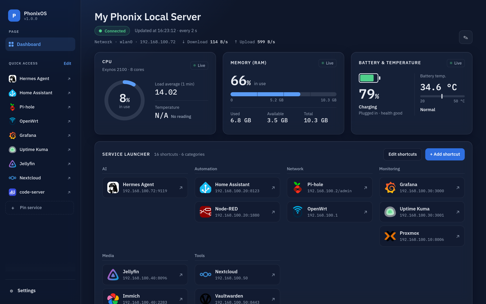
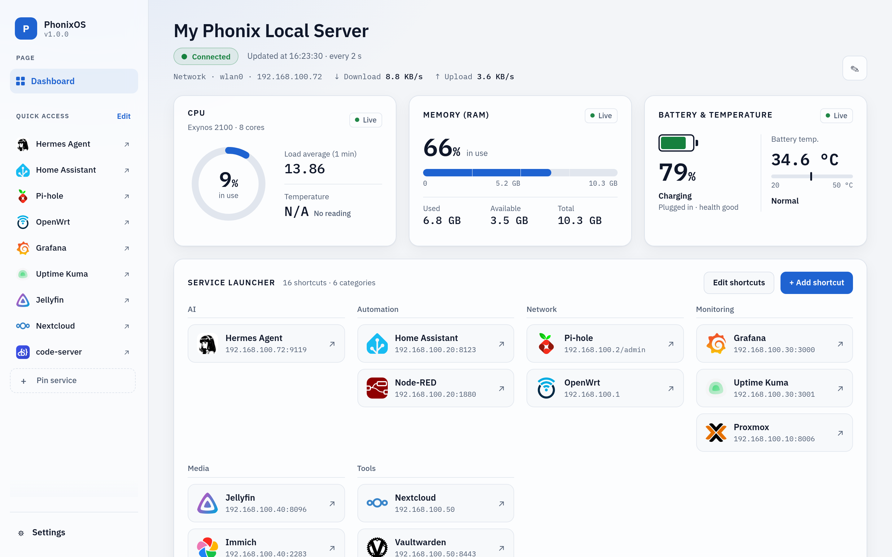
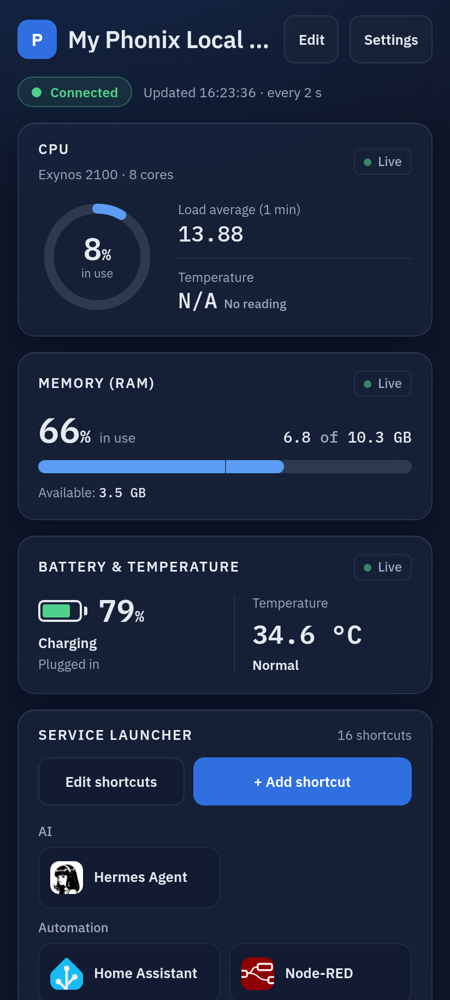
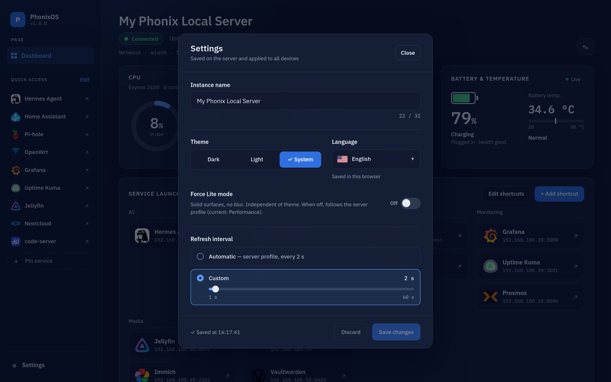
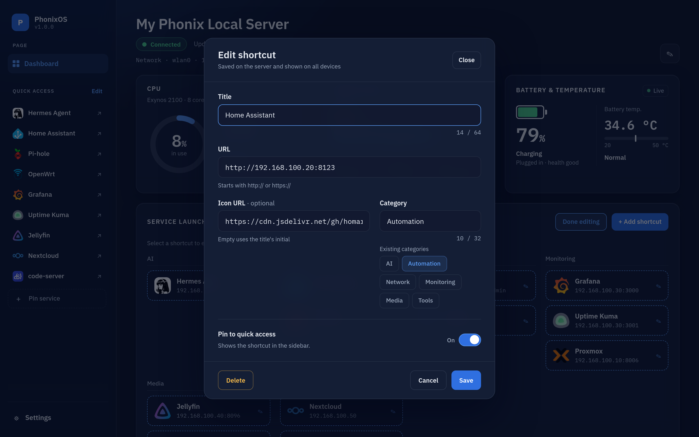
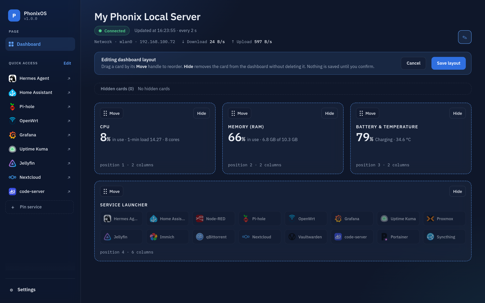
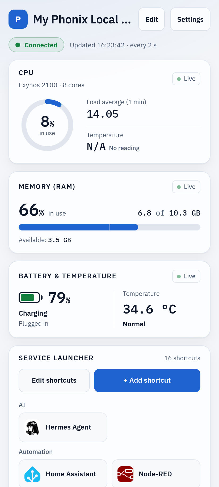

<div align="center">


# PhonixOS

**Turn an old Android phone into a home-lab dashboard — no root required.**

A single static Go binary with an embedded SvelteKit web UI that runs inside Termux, streams live
hardware telemetry, hosts a launcher for your self-hosted services and keeps itself alive with
`runit`.


[](LICENSE)

</div>



---

## Table of contents

- [Screenshots](#screenshots)
- [Features](#features)
- [How it works](#how-it-works)
- [Requirements](#requirements)
- [Installation](#installation)
- [Accessing the dashboard](#accessing-the-dashboard)
- [Telemetry sources and compatibility](#telemetry-sources-and-compatibility)
- [Keeping it running 24/7](#keeping-it-running-247)
- [Configuration](#configuration)
- [API overview](#api-overview)
- [Development](#development)
- [Project structure](#project-structure)
- [Documentation](#documentation)
- [Roadmap](#roadmap)
- [Security notes](#security-notes)
- [License](#license)

## Screenshots

Captured from a real phone (Exynos 2100, Android 15) running PhonixOS in Termux, with the UI in English.

| Light theme | Mobile |
| :---: | :---: |
|  |  |

| Settings | Shortcut editor |
| :---: | :---: |
|  |  |

| Layout editing | Mobile, light theme |
| :---: | :---: |
|  |  |

## Features

**Live telemetry**
- CPU usage, per-core load, load average and SoC model detection (Snapdragon, Exynos, Dimensity,
  Helio, Tensor and generic ARM fallbacks).
- Memory usage, available and total RAM.
- Battery level, charging state, health and temperature.
- Network interface, IPv4 address and live upload/download rates.
- Streamed over a WebSocket with an adjustable refresh interval (1–60 s), paused automatically
  while the browser tab is hidden.
- Honest connection state: readings are marked **Live**, **Stale · HH:MM:SS** or **N/A** — the
  UI never shows invented or outdated values as current.

**Service launcher**
- Shortcuts to your self-hosted services, grouped by category, with icons or initial-letter
  fallbacks.
- Pin favourites to the quick-access sidebar.
- Everything is stored on the server, so every device on the network sees the same dashboard.

**Customisable dashboard**
- Six-column mosaic grid: drag cards by their handle (desktop), move them with ↑/↓ (mobile) or
  the arrow keys, hide and restore cards.
- Dark, light or system theme, and an optional **Lite mode** (solid surfaces, no blur).
- English and Brazilian Portuguese UI; new languages are plain JSON catalogs.
- Responsive from 360 px phones to wide desktops, keyboard accessible, with focus-trapped dialogs.

**Built for old phones**
- Adaptive profile: devices with less than 2 GB of RAM switch to the **Lite** profile (5 s
  cadence, no heavy visual effects); others use the **Performance** profile (2 s cadence).
- One shared hardware collection per tick, regardless of how many browsers are connected.
- SQLite with flash-friendly pragmas; automatically falls back from WAL to TRUNCATE journaling on
  storage without POSIX locks (`/sdcard`, FAT32/exFAT).
- Supervised by `runit` with an HTTP health-check watchdog.
- Zero-conf discovery: announces `phonix.local` and an `_http._tcp` DNS-SD service via a pure-Go
  mDNS responder.
- Installable as a Progressive Web App when served over trusted HTTPS.

## How it works

```text
 Browsers on your LAN / VPN  ──  http://<device-ip>:8080  or  http://phonix.local:8080
                │  REST (/api/v1)  +  WebSocket (/ws/telemetry)
                ▼
┌──────────────────────────── Android phone (Termux, no root) ───────────────────────────┐
│  phonixos  — single static Go binary (Fiber)                                            │
│   ├─ Embedded SvelteKit SPA (static build, service worker)                              │
│   ├─ REST API + WebSocket hub with per-connection cadence                               │
│   ├─ Hardware collector with ordered fallbacks (/proc, /sys, sysinfo, netlink/ioctl,    │
│   │   dumpsys, Termux:API, Java helper via app_process)                                 │
│   ├─ SQLite (modernc.org/sqlite, pure Go) in $APP_DATA_DIR                              │
│   └─ mDNS responder (phonix.local, _http._tcp)                                          │
│  runit (termux-services): phonixos  +  phonixos-health (watchdog)                       │
└─────────────────────────────────────────────────────────────────────────────────────────┘
```

| Layer | Technology | Why |
| :--- | :--- | :--- |
| Backend | Go 1.23, [Fiber v2](https://gofiber.io) | Static binary, ~10–25 MB of RAM, cross-compiles to `arm64`/`armv7` without CGO |
| Frontend | SvelteKit (Svelte 5 runes), Tailwind CSS v4, `adapter-static` | Small bundle, no virtual DOM, built once and embedded with `go:embed` |
| Storage | SQLite via `modernc.org/sqlite` | Transactional, pure Go (no CGO), ~2 MB cache budget |
| Supervision | `runit` via `termux-services` | Sub-second restarts when Android kills the process |
| Discovery | `miekg/dns` responder | `phonix.local` without Avahi or root |

## Requirements

**On the phone**
- Android 7+ with [Termux](https://termux.dev) (F-Droid or GitHub build). The installer adds any
  missing packages itself (`curl`, `coreutils`, `termux-services`).
- **Termux:API — needed for battery information.** Android blocks regular apps from reading the
  battery directly (`/sys/class/power_supply` and `dumpsys` are denied). Without Termux:API,
  level, status, health, temperature and charger state show as **N/A**.
  1. Install the **Termux:API** app from the **same source** as your Termux (F-Droid with
     F-Droid, GitHub with GitHub — different sources use different signatures and cannot talk to
     each other).
  2. In Termux: `pkg install termux-api`.
  3. Check with `termux-battery-status`, which should print JSON containing `percentage`.
     PhonixOS picks this source up automatically, without reinstalling or restarting.

**For building from source:** Go 1.23+, Node.js 22 with npm 10 and, for the Android network
helper, a JDK plus the Android SDK build tools (`d8`, `android.jar`). Docker works fine for the
Go part.

## Installation

### One-line install (Termux)

```sh
curl -sSL https://raw.githubusercontent.com/gustavo-lopes-dev/PhonixOS/dev/deploy/quickstart.sh | bash
```

The quickstart resolves the latest published release (or `--version X.Y.Z`), downloads the
installer and the `runit` templates from that exact tag, and runs `scripts/install.sh`, which:

1. detects the architecture (`aarch64` → `arm64`, `armv7l`/`armv8l` → `armv7`);
2. downloads the prebuilt binary and verifies it against `SHA256SUMS`;
3. installs it atomically to `$HOME/.phonixos/bin/phonixos`;
4. registers the `phonixos` and `phonixos-health` services and waits for the health check;
5. prints the dashboard URLs.

Re-running it is safe: only what changed is replaced and restarted. Exit codes: `0` installed,
`1` missing prerequisite, `2` download/checksum failure, `3` server did not become healthy.

> The one-line installer downloads binaries from
> [GitHub Releases](https://github.com/gustavo-lopes-dev/PhonixOS/releases). Until a release is
> published, build the binary yourself as described below.

### From source

Follow the pipeline in [`docs/release.md`](docs/release.md) — the order matters, because the
frontend must be built before the Go binary embeds it:

```sh
npm --prefix frontend ci
npm --prefix frontend run check
npm --prefix frontend run build
find internal/api/static -mindepth 1 ! -name .gitkeep -exec rm -rf {} +
cp -R frontend/build/. internal/api/static/
scripts/build-android-helper.sh          # Android network helper (JDK + Android SDK); without it, rates may show N/A on newer Android
go test ./...
CGO_ENABLED=0 GOOS=linux GOARCH=arm64 go build -trimpath -ldflags="-s -w" -o dist/phonixos-linux-arm64 ./cmd/server
CGO_ENABLED=0 GOOS=linux GOARCH=arm GOARM=7 go build -trimpath -ldflags="-s -w" -o dist/phonixos-linux-armv7 ./cmd/server
```

Then generate `dist/SHA256SUMS`, serve the `dist/` folder over HTTP on your LAN and run the
installer from a checkout on the phone, pointing it at your own artifacts:

```sh
(cd dist && sha256sum phonixos-linux-arm64 phonixos-linux-armv7 > SHA256SUMS)
# on the phone, inside a checkout of the same commit:
PHONIX_INSTALL_BASE_URL=http://<your-computer-ip>:<port> sh scripts/install.sh
```

## Accessing the dashboard

When the server starts it logs every reachable address:

```text
INFO server available url=http://192.168.1.150:8080
INFO server available via mDNS url=http://phonix.local:8080
```

| Address | Dashboard | PWA install & offline shell |
| :--- | :---: | :---: |
| `http://<device-ip>:8080` | ✅ | ❌ |
| `http://phonix.local:8080` (if your network passes multicast) | ✅ | ❌ |
| `https://<hostname>` through a reverse proxy with a trusted certificate | ✅ | ✅ |

Browsers only enable service workers on secure origins, so installing the app and using the
offline shell require HTTPS — see [`docs/network/https_pwa.md`](docs/network/https_pwa.md).
To reach the dashboard away from home, use a mesh VPN such as Tailscale or WireGuard — see
[`docs/network/remote_access.md`](docs/network/remote_access.md).

## Telemetry sources and compatibility

Android increasingly blocks unprivileged access to `/proc` and `/sys` (SELinux, seccomp). Every
metric therefore walks an ordered chain of sources and uses the first one that answers. The
active source is logged as `collector: telemetry source selected`.

| Metric | Source chain |
| :--- | :--- |
| CPU usage (total and per core) | `/proc/stat` → per-core idle residency from `/sys/devices/system/cpu/*/cpuidle` |
| Load average | `/proc/loadavg` → `sysinfo(2)` |
| CPU model | `getprop ro.soc.*` (Android 12+) → platform codename table → `/proc/cpuinfo` hardware / model name / core composition |
| Interface IPv4 | netlink → `ioctl(SIOCGIFCONF)` |
| Upload/download rates | `/proc/net/dev` → `/sys/class/net/*/statistics` → Java helper via `app_process` (`netstats` per interface on Android 10–13+, `TrafficStats` on 7–12, device totals when only one interface is up) → IP shown with rates **N/A** |
| Battery | sysfs → `dumpsys battery` → Termux:API → **N/A** |

The Java helper runs only while a dashboard is open (about 50 MB of RAM during that time) and
stops 20 s after the last reading.

## Keeping it running 24/7

- **Watchdog.** `phonixos-health` polls `GET /api/v1/health` every 10 s and asks `runit` to
  restart the server after three consecutive failures.
- **Phantom Process Killer (Android 12+).** Android may kill Termux child processes in the
  background. From a computer with ADB, run
  [`scripts/android/disable_phantom_killer.sh`](scripts/android/disable_phantom_killer.sh)
  (`--check` only inspects). It uses `adb shell` only — no root.
- **Battery wear.** [`scripts/android/battery_saver.sh`](scripts/android/battery_saver.sh)
  watches the charge level and alerts you to unplug once it reaches the dashboard's battery
  threshold (80 % by default). It never writes to kernel nodes.
- Disable battery optimisation for Termux and keep the phone on a charger.

## Configuration

| Variable | Default | Purpose |
| :--- | :--- | :--- |
| `APP_DATA_DIR` | `$HOME/data`, then `./data` | Directory of the SQLite database |
| `PHONIX_INSTALL_BASE_URL` | release URL of the current version | Mirror for the installer's binaries and `SHA256SUMS` |
| `PHONIX_VERSION` | latest release | Version requested by the quickstart (same as `--version`) |

The server always listens on port `8080`. Dashboard preferences (instance name, theme, Lite mode,
refresh interval, battery threshold), the layout and the shortcuts are stored in SQLite and
edited from the UI. The UI language is a per-browser preference.

## API overview

All REST responses use the same envelope: `{"success": true, "data": …}` or
`{"success": false, "error": {"code": "…", "message": "…"}}`.

| Method | Route | Description |
| :--- | :--- | :--- |
| `GET` | `/api/v1/health` | Liveness, uptime and version |
| `GET` | `/api/v1/system/profile` | Hardware profile (`lite`/`performance`, RAM, cadence, CPU model) |
| `GET` | `/api/v1/system/metrics` | One-off telemetry snapshot |
| `GET` `POST` | `/api/v1/shortcuts` | List / create shortcuts |
| `PUT` `DELETE` | `/api/v1/shortcuts/:id` | Partially update / delete a shortcut |
| `GET` `PUT` | `/api/v1/layout` | Read / replace the dashboard grid in one batch |
| `GET` `PATCH` | `/api/v1/settings` | Read / partially update dashboard settings |
| `GET` | `/ws/telemetry` | WebSocket telemetry stream |

**WebSocket protocol.** Right after the handshake the server sends `system_profile` followed by
an immediate `telemetry_tick`, then one tick per cadence. Clients may send
`{"action":"pause"}`, `{"action":"resume"}` and `{"action":"set_rate","rate_ms":5000}` (minimum
1000 ms; `0` restores the profile cadence). The cadence applies to that connection only, while the
hardware is collected once per tick for everyone.

**Error codes:** `VALIDATION_FAILED` (400), `INVALID_JSON_BODY` (400), `SHORTCUT_NOT_FOUND`
(404), `CARD_NOT_FOUND` (404), `PAYLOAD_TOO_LARGE` (413, bodies over 4 MB), `UPGRADE_REQUIRED`
(426), `DATABASE_LOCKED` (503), `DATABASE_ERROR`, `HARDWARE_COLLECTOR_FAULT` and
`INTERNAL_SERVER_ERROR` (500).

## Development

Run the backend on your computer (it falls back to mock or host sources when Android ones are
missing) and the frontend dev server, which proxies `/api` and `/ws` to `localhost:8080`:

```sh
# Terminal 1 — backend with a throwaway database
APP_DATA_DIR="$(mktemp -d)" go run ./cmd/server

# Terminal 2 — frontend with hot reload
npm --prefix frontend install
npm --prefix frontend run dev
```

Checks before sending changes:

```sh
gofmt -l cmd internal          # no output expected
go vet ./...
go test ./...
npm --prefix frontend run check  # svelte-check + i18n catalog validation
```

**Adding a language.** Copy `frontend/src/lib/i18n/locales/en-US/` to a new BCP 47 folder,
translate the JSON files, adjust `meta.json` (native name and text direction) and run
`npm --prefix frontend run check`. No TypeScript changes are needed — see
[`frontend/src/lib/i18n/README.md`](frontend/src/lib/i18n/README.md).

## Project structure

```text
cmd/server/              entry point: profile detection, collectors, HTTP server, mDNS, shutdown
internal/
  api/                   Fiber server, envelopes, error catalog, embedded SPA (static/)
    handlers/            REST handlers (system, shortcuts, layout, settings)
    ws/                  WebSocket hub, per-connection cadence, shared broadcaster
  collector/             CPU, memory, battery and network collectors with fallback chains
  androidhelper/         Java helper (app_process) for network counters on newer Android
  database/              SQLite setup, pragmas, POSIX lock probe, migrations, repositories
  network/               interface discovery and the mDNS responder
  profile/               RAM-based profile and CPU model detection
frontend/                SvelteKit SPA (components, stores, WebSocket client, i18n catalogs)
scripts/                 installer, release config, runit templates, Android utilities
deploy/quickstart.sh     public one-line installer
docs/                    release pipeline, HTTPS/PWA and remote access guides, screenshots
```

## Documentation

- [`docs/release.md`](docs/release.md) — build pipeline, artifact matrix and release publishing.
- [`docs/network/https_pwa.md`](docs/network/https_pwa.md) — trusted HTTPS for PWA install and offline use.
- [`docs/network/remote_access.md`](docs/network/remote_access.md) — Tailscale / WireGuard access.
- [`frontend/src/lib/i18n/README.md`](frontend/src/lib/i18n/README.md) — translation catalogs.

## Roadmap

All five planned phases are implemented:

- [x] **Phase 1** — adaptive metric collection and resilient POSIX/SQLite storage.
- [x] **Phase 2** — REST API and low-overhead WebSocket streaming.
- [x] **Phase 3** — dashboard UI, mosaic grid, launcher, settings and PWA.
- [x] **Phase 4** — watchdog, Android power-management helpers and the installer.
- [x] **Phase 5** — mDNS discovery, remote-access guides and the one-line installer.

Ideas for the future: CPU temperature, a built-in terminal view and history charts.

## Security notes

PhonixOS has **no authentication**. It is designed for a trusted LAN or a private VPN.
**Never expose port `8080` to the internet** (router port forwarding, DMZ or public tunnels). For
remote access use a mesh VPN, and for HTTPS put a reverse proxy with a trusted certificate in
front of it.

## License

PhonixOS is released under the [MIT License](LICENSE). Third-party components bundled in the
release binaries (Go modules, the Svelte runtime and the IBM Plex fonts under the SIL Open Font
License 1.1) are listed in [`THIRD_PARTY_NOTICES.md`](THIRD_PARTY_NOTICES.md).
